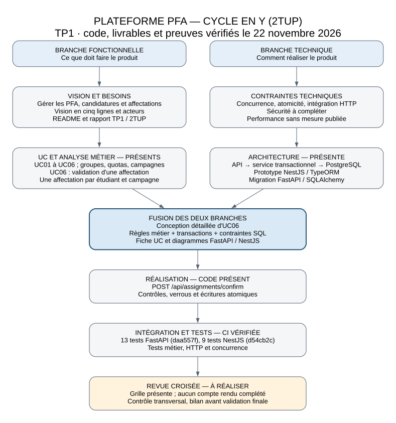

# Plateforme de gestion des PFA

Ce projet vise à centraliser la gestion des projets de fin d’année (PFA) : campagnes, sujets proposés par les enseignants, propositions étudiantes, candidatures et affectations définitives. Trois acteurs interviennent : **l’administration, les enseignants et les étudiants**.

Ce README documente le travail du **TP1** et son analyse selon le **cycle en Y (2TUP)** : séparation des besoins fonctionnels et des contraintes techniques, puis réunion des deux branches dans une réalisation commune.

> **Périmètre vérifié :** dépôt au commit `daa557f5a9afd63eea51bf89e02dd443ae5c0663`. Le code réalise principalement **UC06 — Valider une affectation**. Les autres UC sont décrits dans les modèles, mais leurs parcours complets ne sont pas implémentés. Les tests et workflows cités sont présents ; ils n’ont pas été exécutés lors de cette rédaction. La revue croisée reste à réaliser selon le document de traçabilité.

## 1. Vision et travail déjà réalisé

### Vision du produit

Permettre aux étudiants de candidater à un PFA et aux enseignants de confirmer les affectations, tout en respectant les capacités d’encadrement et l’unicité d’affectation de chaque étudiant par campagne.

Cette vision est une **synthèse rédigée ici à partir du modèle métier et des UC du dépôt**. Aucun livrable de vision autonome n’a été retrouvé.

### Cas d’utilisation identifiés

| ID | Cas d’utilisation | Acteur principal | État observable dans le dépôt |
|---|---|---|---|
| UC01 | Gérer une campagne PFA | Administration | Modélisé ; données minimales initialisées par SQL |
| UC02 | Publier et gérer les sujets | Enseignant | Modélisé ; sujets de démonstration initialisés par SQL |
| UC03 | Proposer un projet personnel | Étudiant | Modélisé ; une candidature peut avoir un titre propre et aucun sujet enseignant |
| UC04 | Consulter les sujets et déposer une candidature | Étudiant | Modélisé ; pas de parcours utilisateur complet |
| UC05 | Examiner et traiter les candidatures | Enseignant | Modélisé ; UC06 attend une candidature déjà favorable |
| UC06 | Valider une affectation | Enseignant | Endpoint, logique métier, persistance et tests présents |

Source : [diagramme des cas d’utilisation](docs/uml/diagramme-cas-utilisation.puml).

La première réalisation utilise **NestJS / TypeORM** dans [`backend/`](backend/README.md). Une migration vers **FastAPI / SQLAlchemy** a été ajoutée dans [`backend-fastapi/`](backend-fastapi/README.md). Les deux versions sont encore présentes ; la description de l’API ci-dessous prend la version FastAPI comme référence, sans supposer que toute la migration est achevée.

## 2. Exigences fonctionnelles et techniques

Les exigences fonctionnelles décrivent **ce que le système doit permettre ou garantir du point de vue métier**. Les exigences techniques précisent **les contraintes de réalisation et les qualités attendues**. Les deux colonnes sont deux listes indépendantes : les éléments d’une même ligne ne constituent pas nécessairement une paire.

| Fonctionnel | Technique |
|---|---|
| **F01 — Gérer les campagnes PFA.** L’administration organise les campagnes. Les dates et la taille maximale des groupes figurent dans la conception générale ; leur gestion complète reste à réaliser. | **T01 — Plateforme.** Fournir un service HTTP reposant sur FastAPI, SQLAlchemy et PostgreSQL 16 pour la version Python. Le workflow Python utilise Python 3.12 ; Docker Compose fournit la base de développement. **Présent dans la configuration.** |
| **F02 — Gérer les sujets et les propositions.** Un PFA peut provenir d’un sujet enseignant ou d’une proposition étudiante. Les parcours de publication et de soumission restent à réaliser. | **T02 — Intégrité et concurrence.** Confirmer une affectation dans une transaction atomique, avec verrous et contraintes SQL, pour préserver les règles métier en cas de requêtes simultanées. **Implémenté ; scénarios de test présents.** |
| **F03 — Contrôler l’éligibilité d’une candidature.** Seule une candidature `FAVORABLE`, appartenant à un groupe non vide dont tous les membres ont confirmé, peut être affectée. **Implémenté dans UC06.** | **T03 — Sécurité des accès.** Authentifier l’utilisateur et réserver la confirmation à l’enseignant autorisé. **Exigence à implémenter : l’endpoint actuel ne vérifie pas l’identité ni les droits de l’appelant.** |
| **F04 — Respecter le quota d’encadrement.** Le quota porte sur le nombre de **PFA**, pas sur le nombre d’étudiants. Un groupe de trois membres consomme une place. **Implémenté.** | **T04 — Performance.** Limiter le coût des recherches de quota, de membres et de candidatures grâce aux index SQL et à des transactions courtes. **Index présents ; aucun objectif chiffré de latence ou de charge ni résultat de test de performance retrouvé.** Un seuil devra être fixé avant validation de cette qualité. |
| **F05 — Éviter les doubles affectations.** Un étudiant ne peut avoir qu’une affectation définitive par campagne, même s’il appartient à plusieurs groupes candidats. **Implémenté.** | **T05 — Intégration.** Exposer un contrat HTTP/JSON : `POST /api/assignments/confirm`, entrée `applicationId` au format UUID, réponse nominale `201`, candidature absente `404`, conflit métier `409`, entrée invalide `422` dans FastAPI. **Présent dans l’API et ses tests.** |
| **F06 — Confirmer tout le groupe.** La confirmation crée l’affectation et ses membres, puis passe la candidature à `AFFECTEE`. Un échec ne doit pas laisser une affectation partielle. **Implémenté.** | **T06 — Testabilité et reproductibilité.** Versionner le schéma SQL, automatiser les tests et utiliser une base PostgreSQL isolée pour les scénarios transactionnels. **Scripts, tests Pytest et workflow GitHub Actions présents ; succès d’exécution non vérifié ici.** |

Sources techniques : [service de confirmation](backend-fastapi/app/service.py), [contrat de l’API](backend-fastapi/app/main.py), [schéma et index SQL](backend-fastapi/database/01_schema.sql), [configuration PostgreSQL](backend-fastapi/compose.yml), [workflow FastAPI](.github/workflows/fastapi-ci.yml).

**Distinction importante :** « un étudiant ne peut être affecté qu’une fois par campagne » est une règle fonctionnelle. La contrainte SQL `UNIQUE (campaign_id, student_id)` et les verrous qui la protègent sont des moyens techniques de la respecter.

## 3. Cycle en Y du projet et livrables du TP1



Source modifiable du schéma : [Graphviz DOT](docs/uml/cycle-en-y-pfa.dot). Une [version PNG](docs/uml/cycle-en-y-pfa.png) est également disponible pour le rapport. Le schéma représente l’organisation des livrables, pas une preuve que toutes les étapes sont terminées.

### Branche fonctionnelle : ce que doit faire le produit

La vision et les acteurs conduisent aux six UC. L’analyse métier précise ensuite les entités et les règles : campagnes, groupes, candidatures, quotas et affectations. Le parcours à risque retenu dans les documents et le code est **UC06**.

### Branche technique : comment réaliser le produit

Les contraintes de concurrence et de persistance conduisent à une architecture en couches et à une base PostgreSQL transactionnelle. Le prototype NestJS constitue la première réalisation ; FastAPI reprend ensuite la confirmation d’affectation dans la migration Python.

### Fusion des branches

La fusion se fait à la **conception détaillée d’UC06** : chaque règle métier est associée à une opération concrète dans le service, à une contrainte de base et à un scénario de test. Par exemple, le quota métier devient un contrôle réalisé après verrouillage de la ligne enseignant/campagne, et l’unicité par étudiant devient une vérification accompagnée d’une contrainte SQL.

Cette fusion désigne la réunion de l’analyse fonctionnelle et de la conception technique ; elle ne désigne pas une fusion de branches Git. Elle mène à l’implémentation, à l’intégration et à la validation de la même tranche fonctionnelle.

### Position des livrables

| Livrable | Position dans le Y | Preuve et état |
|---|---|---|
| Vision | Entrée de la branche fonctionnelle | Synthèse en section 1 ; aucun document de vision séparé retrouvé |
| UC et analyse métier | Branche fonctionnelle | [Six UC](docs/uml/diagramme-cas-utilisation.puml), [modèle conceptuel](docs/uml/Diagrammes/README_Modele_PFA.md) et [parcours de candidature](docs/uml/Diagrammes/plantuml/02_parcours_candidature.puml) présents |
| Architecture | Branche technique | [Décisions techniques initiales](backend/docs/DECISIONS_TECHNIQUES.md), [composants UC06](docs/uml/uc06-diagramme-composants.puml) et code des deux backends présents |
| Conception détaillée | Point de fusion | [Classes d’implémentation](docs/uml/construction/uc06_classes_implementation.puml) et [séquence d’implémentation](docs/uml/construction/uc06_sequence_implementation.puml) présentes ; ces vues décrivent NestJS |
| Réalisation UC06 | Tronc commun après fusion | [Service NestJS](backend/src/assignments/assignments.service.ts) et [service FastAPI](backend-fastapi/app/service.py) présents |
| Tests | Préparés à partir des règles et des risques ; exécutés sur la réalisation intégrée | [Tests métier](backend-fastapi/tests/test_policy.py), [tests HTTP](backend-fastapi/tests/test_api.py), [tests transactionnels et concurrents](backend-fastapi/tests/test_uc06_transactions.py), [CI](.github/workflows/fastapi-ci.yml) présents ; exécution non vérifiée ici |
| Revue croisée | Contrôle transversal de l’analyse à la validation ; bilan placé en fin de tronc | [Grille de revue](docs/uml/construction/uc06_tracabilite_construction.md) présente, mais portant explicitement la mention **« revue non effectuée »** |

Les documents conceptuels plus anciens contiennent encore des mentions « proposition » ou « non implémenté ». Ils décrivent leur état au moment de leur rédaction. Pour l’état actuel, distinguer ces modèles, la [traçabilité de construction NestJS](docs/uml/construction/uc06_tracabilite_construction.md) et le code FastAPI. De même, le README FastAPI annonce encore le portage des tests concurrents comme restant à faire, alors que leur fichier et leur activation dans la CI sont désormais présents.

## 4. Architecture et exemple concret d’UC06

Le prototype actuel ne comporte pas d’interface utilisateur complète. L’API peut être appelée depuis un client HTTP ou sa documentation interactive.

```text
Client HTTP / documentation interactive
                 |
                 | POST /api/assignments/confirm
                 | { "applicationId": "<UUID de la candidature>" }
                 v
FastAPI : validation du corps de requête et traduction des erreurs HTTP
                 |
                 v
Service confirm_assignment : contrôles métier et transaction SQLAlchemy
                 |
                 v
PostgreSQL 16 : verrous, contraintes d’unicité et persistance
```

Exemple : un enseignant dispose d’une seule place restante. Deux candidatures favorables de groupes différents sont confirmées simultanément. Le service verrouille la capacité de cet enseignant pour la campagne : une requête peut obtenir la dernière place ; l’autre doit constater le quota atteint et retourner un conflit `409`.

Dans le service, la transaction englobe les contrôles et les écritures. Elle verrouille la capacité, la candidature puis les étudiants dans l’ordre de leurs identifiants ; elle crée l’affectation et ses membres avant de mettre à jour le statut. Les contraintes d’unicité sur la candidature, le sujet et le couple étudiant/campagne constituent une protection complémentaire. Le prototype interdit ainsi aussi la réattribution d’un même sujet enseignant, même si cette politique était encore ouverte dans les premiers modèles.

Les tests `test_concurrence_derniere_place` et `test_concurrence_meme_etudiant_deux_enseignants` expriment le résultat attendu : **une réponse `201`, une réponse `409` et une seule affectation enregistrée**. Leur présence ne remplace pas un journal attestant leur réussite.

## 5. Réponses aux questions techniques

### Quelle contrainte technique a influencé le choix de l’UC à risque ?

La contrainte principale est la **cohérence transactionnelle lors des confirmations concurrentes**. Deux requêtes peuvent lire simultanément un quota encore disponible ou tenter d’affecter le même étudiant auprès de deux enseignants. UC06 concentre donc les risques de dépassement de capacité, de double affectation et d’écriture partielle. Ce risque est explicitement documenté dans la décision [DT-03](backend/docs/DECISIONS_TECHNIQUES.md) et justifie le choix de cet UC pour éprouver l’architecture : transaction PostgreSQL, verrous `FOR UPDATE`, contraintes d’unicité et tests concurrents.

### Qu’aurions-nous changé pour une application mobile hors ligne ?

Nous aurions ajouté une base locale sur le mobile, un cache des sujets et une file de demandes à synchroniser, avec des identifiants permettant de rejouer une demande sans créer de doublon. La consultation et la préparation d’une candidature seraient possibles hors ligne, mais l’application afficherait une demande comme **« en attente de synchronisation »**, sans annoncer d’affectation définitive.

La confirmation finale resterait arbitrée par le serveur connecté : un téléphone hors ligne ne peut pas connaître avec certitude le quota restant ni les affectations décidées ailleurs. L’UC à risque deviendrait donc **la synchronisation d’une candidature et la résolution des conflits d’affectation**, en prolongement d’UC06. Nous ajouterions des tests de coupure réseau, de rejeu, de données périmées et de conflits au retour en ligne, ainsi qu’une protection des données stockées sur le terminal. Cette variante est une proposition d’évolution ; elle n’est pas implémentée dans le dépôt.

## 6. Exécution et vérification

Le [guide FastAPI](backend-fastapi/README.md) fournit les commandes de démarrage. PostgreSQL utilise le port hôte `5433` dans cette version afin de coexister avec l’ancien backend. La documentation interactive est accessible à [localhost:8000/docs](http://127.0.0.1:8000/docs) après lancement du serveur.

Pour la validation complète, le [workflow FastAPI](.github/workflows/fastapi-ci.yml) crée une base PostgreSQL 16 nommée `pfa_test_db`, initialise le schéma, active `RUN_PFA_DB_TESTS=1` et lance `python -m pytest -v -rs`. Sans cette activation, les tests nécessitant PostgreSQL sont ignorés : une exécution locale partielle ne prouve donc pas les garanties transactionnelles.

**Les tests transactionnels vident leurs tables entre les scénarios et exigent une base jetable nommée `pfa_test_db`.** Ne pas les diriger vers une base contenant des données à conserver.

Pour régénérer le schéma en Y avec Graphviz depuis la racine du dépôt :

```powershell
dot -Tsvg docs/uml/cycle-en-y-pfa.dot -o docs/uml/cycle-en-y-pfa.svg
```

## 7. Limites et preuves à compléter

- **Sécurité :** ajouter l’authentification et le contrôle de l’enseignant autorisé ; l’endpoint actuel est un prototype de démonstration.
- **Règles encore absentes :** contrôler la période de campagne et la taille maximale des groupes ; encadrer les modifications de composition d’un groupe pendant une confirmation.
- **Validation :** joindre les résultats effectifs des tests et le lien d’une exécution CI réussie pour le commit présenté.
- **Revue croisée :** renseigner l’équipe évaluatrice, la date, ses observations et les corrections dans la grille existante.
- **Suite Agile/Scrum :** le cycle en Y présenté ici décrit l’articulation entre analyse et réalisation. L’organisation Scrum et le suivi Jira demandés pour la suite doivent s’appuyer sur ce périmètre réel ; aucun sprint réalisé, rôle nominatif ou rapport Jira n’est attesté par les fichiers consultés.

Le [protocole de validation TP1](docs/NOTE_VALIDATION_UC06.md) et la [traçabilité de construction](docs/uml/construction/uc06_tracabilite_construction.md) recensent les justificatifs attendus pour clôturer le travail.
