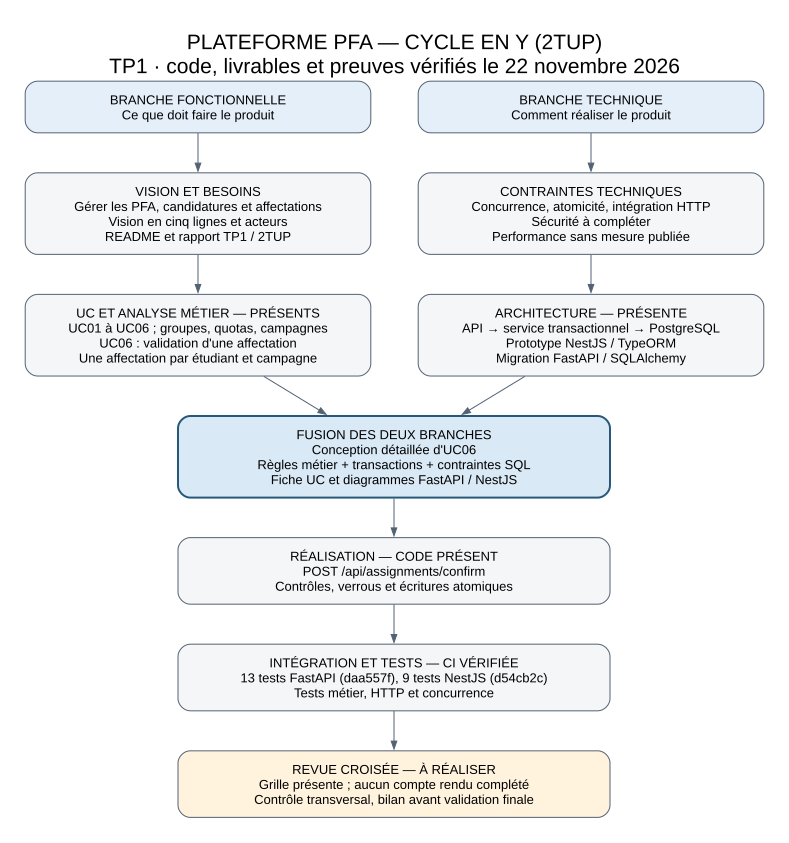

# TP1 — Processus unifié et application du 2TUP

Ce dossier répond au sujet **« TP1 — Processus unifié et Approches Agiles »**, fourni par l’enseignante Hajer TAKTAK : cadrage et planification (page 2), Élaboration (page 3), Construction et Transition (page 4). Le complément 2TUP répond également aux questions sur les exigences et le cycle en Y communiquées avec le projet.

**Vérification : 22 novembre 2026.** Référence du dépôt avant ces compléments : `d54cb2c`. Les faits observés, les compléments rédigés et les travaux futurs sont distingués. Le TP demande de lister 4 à 6 UC et d’implémenter l’UC à risque ; il ne demande pas explicitement d’achever toute la plateforme avant de rendre cette tranche.

## 1. Vision en cinq lignes et acteurs

La gestion des PFA doit centraliser les sujets, les candidatures et les décisions d’affectation pour éviter leur dispersion. 
Les étudiants consultent les sujets ou proposent un projet personnel, seuls ou en groupe, puis déposent leurs candidatures. 
Les enseignants publient des sujets, examinent les candidatures et confirment les PFA qu’ils encadrent. 
L’administration définit les campagnes et les contraintes d’organisation, notamment les capacités d’encadrement. 
La valeur attendue est une affectation cohérente de chaque groupe, sans double affectation d’un étudiant ni dépassement de quota.

Cette vision est formalisée dans ce complément à partir des tickets et des modèles existants. Les trois acteurs sont **Étudiant**, **Enseignant** et **Administration** ; ils figurent dans le [diagramme des UC](uml/diagramme-cas-utilisation.puml).

## 2. Priorisation des six UC

Échelle : **1 = faible, 5 = élevé**. Le score est la somme de la valeur métier, du risque technique et de l’impact sur l’architecture, sur 15. Les notes d’UC01 à UC05 proviennent des tickets GitHub existants ; les notes d’UC06 sont une proposition explicitée ici, cohérente avec le risque de concurrence décrit dans son ticket. L’ordre tient aussi compte des dépendances : une priorité élevée ne permet pas d’ignorer les données nécessaires à un UC.

| UC | Valeur métier | Risque technique | Impact architecture | Total | Justification et décision |
|---|---:|---:|---:|---:|---|
| UC06 — Valider une affectation | 5 | 5 | 5 | **15** | Concurrence sur quotas et étudiants ; premier UC exécutable pour éprouver l’architecture |
| UC04 — Consulter et candidater | 5 | 3 | 4 | **12** | Entrée du parcours étudiant ; composition des groupes et règles de candidature |
| UC05 — Examiner les candidatures | 5 | 3 | 4 | **12** | Décision pédagogique et transitions de statut ; prépare UC06 |
| UC01 — Gérer une campagne | 4 | 2 | 5 | **11** | Campagnes et quotas structurent les autres UC ; données minimales nécessaires dès l’Élaboration |
| UC03 — Proposer un projet personnel | 4 | 3 | 3 | **10** | Second parcours de candidature ; réutilise groupes et affectations |
| UC02 — Publier les sujets | 4 | 2 | 3 | **9** | Fournit le catalogue nécessaire au parcours UC04 |

**À traiter en premier : UC06, avec les données minimales de campagne, de groupe et de candidature.** Les scripts SQL fournissent ces préconditions dans le prototype ; ils ne constituent pas une implémentation des écrans UC01 à UC05. Pour une extension au produit complet, l’ordre de dépendance proposé est UC01 → UC02 → UC04 → UC05, puis UC03 en réutilisant les éléments communs. UC06 est intégré dès l’Élaboration au lieu d’attendre la fin de ce parcours.

## 3. Trois itérations, quatre phases et jalons

Il s’agit d’une **planification de référence formalisée maintenant**, pas d’un calendrier historique reconstitué. Durées proposées : trois itérations de deux semaines, à adapter à la disponibilité réelle de l’équipe. Une itération n’est pas une phase : la première couvre ici le cadrage d’Inception puis l’Élaboration.

| Itération | Période relative proposée | Phases et travail | Résultat et contrôle de sortie |
|---|---|---|---|
| I1 — Réduire le risque | Semaines 1–2 | **Inception** : vision, acteurs, six UC, priorisation ; **Élaboration** : architecture et première route UC06, données SQL, premier test CI | Jalon LCO après le cadrage ; jalon LCA après démonstration de la route et test CI réussi |
| I2 — Construire UC06 | Semaines 3–4 | **Construction** : fiche détaillée, diagrammes, règles métier, transaction, cas alternatifs et tests ; migration Python du même parcours | Jalon IOC : tranche UC06 intégrée, reproductible et testée ; demande de revue croisée préparée |
| I3 — Vérifier et livrer | Semaines 5–6 | **Transition** : démonstration, revue par une autre équipe, correction des remarques, vérification de la documentation et du suivi | Jalon PR : version pédagogique livrable et bilan de revue disponible |

LCO = objectifs du cycle de vie ; LCA = architecture du cycle de vie ; IOC = capacité opérationnelle initiale ; PR = livraison du produit dans le périmètre convenu. Une clôture de milestone ne suffit pas à prouver que son critère de sortie est satisfait.

| Phase / milestone GitHub | Jalon et convention de tag | État observé / action |
|---|---|---|
| [01 - Inception](https://github.com/babbouomar12/pfa-management-platform/milestone/1) | LCO ; `v0.0-inception` proposé | Milestone fermé ; aucun tag Inception retrouvé. La vision et la synthèse des priorités sont désormais documentées. Ne pas inventer une validation passée. |
| [02 - Elaboration](https://github.com/babbouomar12/pfa-management-platform/milestone/2) | LCA ; `v0.1-elaboration` demandé par le TP | Milestone fermé ; tag existant mais ciblant un commit documentaire sans code. Voir la correction de traçabilité ci-dessous. |
| [03 - Construction](https://github.com/babbouomar12/pfa-management-platform/milestone/3) | IOC ; `v0.2-construction` proposé | Milestone ouvert avec UC01–UC05 ; périmètre plus large que la seule tranche UC06. Ne pas fermer ce milestone tant que ces tickets y restent inachevés. |
| [04 - Transition](https://github.com/babbouomar12/pfa-management-platform/milestone/4) | PR ; `v1.0-transition` proposé | Milestone ouvert ; tag à poser après revue et recette du périmètre effectivement livré. |

### Anomalie du tag d’Élaboration

`v0.1-elaboration` cible `4aad1cd`. Son message annonce des tests et une CI réussis, mais `git ls-tree -r v0.1-elaboration` montre seulement le README et les diagrammes : **aucun backend, aucun test, aucun workflow**. Le code NestJS apparaît ensuite dans `63c198a`. Le tag ne peut donc pas servir de preuve du jalon « architecture exécutable » demandé page 3.

Les preuves valides portent sur des commits ultérieurs, notamment `daa557f` pour FastAPI et `d54cb2c` pour NestJS. Une référence corrective **`v0.1.1-elaboration`** permet de pointer un état contenant code, tests et documentation sans réécrire le tag publié. Elle ne remplace pas littéralement le nom imposé par l’énoncé : si ce nom exact est exigé, le déplacement de `v0.1-elaboration` doit être décidé avec l’équipe et annoncé aux personnes qui l’utilisent. Aucun tag historique ne doit être déplacé silencieusement.

## 4. Mise en pratique du 2TUP

Le 2TUP est appliqué comme une organisation de l’analyse et de la réalisation. Le schéma seul ne suffit pas : les deux branches doivent déboucher sur les mêmes règles implémentées et vérifiées. Les phases UP de la section précédente décrivent le déroulement ; les branches du Y décrivent les deux axes de travail qui se rejoignent à chaque incrément.

### Branche fonctionnelle

1. Formaliser la vision, les trois acteurs et les six UC.
2. Identifier UC06 comme risque prioritaire et écrire sa [fiche détaillée](UC06_AFFECTATION.md).
3. Analyser les campagnes, groupes, candidatures et affectations ; un groupe individuel comporte un membre.
4. Définir les critères métier : candidature favorable, groupe confirmé, quota en PFA et unicité par étudiant/campagne.

### Branche technique

1. Identifier la concurrence, la persistance atomique et le contrat HTTP comme contraintes structurantes.
2. Choisir une architecture en couches : entrée HTTP, service métier et accès PostgreSQL dans une transaction.
3. Éprouver cette architecture avec NestJS/TypeORM, puis reprendre le même contrat métier dans FastAPI/SQLAlchemy.
4. Préparer les tests unitaires et les tests d’intégration sur PostgreSQL 16, y compris les demandes simultanées.

### Fusion et tronc commun

La **conception détaillée d’UC06** réunit les règles de la branche fonctionnelle et les mécanismes de la branche technique. Les [classes et modules FastAPI](uml/construction/uc06_fastapi_classes.puml) et la [séquence FastAPI](uml/construction/uc06_fastapi_sequence.puml) représentent cette fusion sur le code actuel. Les diagrammes [NestJS](uml/construction/uc06_classes_implementation.puml) sont conservés comme vue de la première réalisation.

| Besoin fonctionnel | Réponse technique dans UC06 | Preuve de réalisation / test |
|---|---|---|
| Ne confirmer qu’une candidature favorable | Contrôle du statut avant les écritures | `confirm_assignment` ; `test_candidature_non_favorable_aucune_ecriture` |
| Affecter tous les membres confirmés | `all_members_confirmed`, transaction et une ligne par membre | `test_members` ; `test_affectation_nominale_atomique` ; `test_membre_non_confirme_aucune_ecriture` |
| Respecter le quota en nombre de PFA | Verrou sur la capacité enseignant/campagne, puis comptage des affectations | `test_capacity` ; `test_capacite_atteinte` ; `test_concurrence_derniere_place` |
| Un étudiant affecté une seule fois par campagne | Verrous étudiants ordonnés, vérification et `UNIQUE(campaign_id, student_id)` | `test_double_affectation_deux_enseignants` ; `test_concurrence_meme_etudiant_deux_enseignants` |
| Éviter une seconde confirmation identique | Contrôle du statut et unicité de `application_id` | `test_reconfirmation_refusee_sans_doublon` |

Sources : [service](../backend-fastapi/app/service.py), [règles métier](../backend-fastapi/app/policy.py), [contraintes SQL](../backend-fastapi/database/01_schema.sql), [tests transactionnels](../backend-fastapi/tests/test_uc06_transactions.py), [tests unitaires](../backend-fastapi/tests/test_policy.py).

Le tronc commun comprend l’implémentation, l’intégration, les tests et la revue. **La revue croisée n’est pas remplacée par cette vérification documentaire.** Le tableau fonctionnel/technique et la réponse au scénario mobile hors ligne figurent dans le [README](../README.md).

## 5. Tableau de bord et chaîne de traçabilité

Tableau vérifié dans le navigateur : **[BOARD PFA PU — View 1](https://github.com/users/babbouomar12/projects/1/views/1)**. Le 22 novembre 2026, les cinq UC de gestion étaient en `Todo`, UC06 en `In Progress`, et aucun ticket en `Done`. Le statut d’un ticket décrit son suivi, pas à lui seul la présence ou l’absence de code.

| UC | Ticket | Branche distante existante | État du tableau |
|---|---|---|---|
| UC01 | [#2](https://github.com/babbouomar12/pfa-management-platform/issues/2) | `feature/uc01-campagne` | Todo |
| UC02 | [#3](https://github.com/babbouomar12/pfa-management-platform/issues/3) | `feature/uc02-sujets` | Todo |
| UC03 | [#4](https://github.com/babbouomar12/pfa-management-platform/issues/4) | `feature/uc03-proposition` | Todo |
| UC04 | [#5](https://github.com/babbouomar12/pfa-management-platform/issues/5) | `feature/uc04-candidature` | Todo |
| UC05 | [#6](https://github.com/babbouomar12/pfa-management-platform/issues/6) | `feature/uc05-evaluation` | Todo |
| UC06 | [#1](https://github.com/babbouomar12/pfa-management-platform/issues/1) | `feature/uc06-affectation` | In Progress |

Les six branches pointaient toutes sur `daa557f` lors de la vérification ; leur existence ne prouve donc pas six développements terminés. La migration Python est traçable par la [PR #11](https://github.com/babbouomar12/pfa-management-platform/pull/11), issue de `migration/fastapi` et fusionnée dans `main`.

Chaîne concrète : **[fiche UC06](UC06_AFFECTATION.md) → [ticket #1](https://github.com/babbouomar12/pfa-management-platform/issues/1) → `feature/uc06-affectation` / PR de migration → [classes](uml/construction/uc06_fastapi_classes.puml) et [séquence](uml/construction/uc06_fastapi_sequence.puml) → [service](../backend-fastapi/app/service.py) → [tests](../backend-fastapi/tests/test_uc06_transactions.py) → [preuve CI](NOTE_VALIDATION_UC06.md)**.

UC06 reste ouvert alors que son milestone d’Élaboration est fermé. Pour la clôture pédagogique, distinguer l’architecture déjà testée des preuves encore attendues en Transition, et aligner ticket, colonne du tableau et bilan de revue sans marquer ces derniers terminés prématurément.

## 6. Vérification du sujet, point par point

| Exigence du TP | Constat avant complément | État après complément / preuve |
|---|---|---|
| Vision en cinq lignes et acteurs (p. 2) | Vision courte ; acteurs présents | Vision en cinq lignes, section 1 et README |
| Quatre à six UC dont un à risque (p. 2) | Six UC et risque UC06 présents | Conforme au périmètre ; diagramme et tickets liés |
| Priorisation sur trois critères (p. 2) | Notes présentes dans les tickets UC01–UC05, sans synthèse dans le dépôt | Tableau section 2 ; proposition chiffrée UC06 explicitée |
| Trois itérations et quatre phases/jalons (p. 2) | Milestones présents ; plan absent du dépôt | Plan relatif proposé en section 3 ; aucune date de réalisation inventée |
| Dépôt, tableau, tickets, branches et milestones (p. 3) | Existent et ont été vérifiés | Liens et état en section 5 ; tags de fin de phase à gérer selon les validations |
| UC PlantUML versionnés (p. 3) | Présents | [Source](uml/diagramme-cas-utilisation.puml) |
| Route de bout en bout et premier test CI réussi (p. 3) | Implémentés ; preuve absente du README initial | Journaux GitHub consultés : 13 tests Python et 9 tests NestJS réussis ; [détails](NOTE_VALIDATION_UC06.md) |
| Tag `v0.1-elaboration` et milestone fermé (p. 3) | Tag et clôture présents, mais mauvais commit tagué | Anomalie documentée ; référence corrective distincte, ancien tag conservé |
| Fiche UC, classes et séquence PlantUML (p. 4) | Fiche dans le ticket ; diagrammes d’implémentation limités à NestJS | Fiche versionnée et deux diagrammes FastAPI ajoutés |
| Implémentation en couches (p. 4) | Route, service, règles pures et accès SQL présents | Code existant documenté ; pas de classes ORM ou repository Python inventés |
| Tests unitaires et intégration du nominal (p. 4) | Présents et réussis en CI | Correspondance fiche → tests explicitée ; 2 tests unitaires rejoués localement |
| Revue croisée par une autre équipe (p. 4) | Grille non remplie | **Reste à réaliser par une autre équipe** ; grille et critères ci-dessous |
| Complément 2TUP demandé avec le projet | Tableau et Y présents mais peu reliés aux preuves | Branches, fusion, phases et traçabilité exigence → mécanisme → test explicitées |

## 7. Revue croisée et conditions de clôture

**Statut : non réalisée.** À remplir par une autre équipe, sans attribuer cette revue à un outil ou à l’auteur du code.

| Information | À renseigner par les participants |
|---|---|
| Équipe évaluatrice et membres | À compléter |
| Date et commit examiné | À compléter |
| Commandes exécutées / liens CI consultés | À compléter |
| Observations et sévérité | À compléter |
| Corrections, commits et décisions motivées | À compléter |
| Conclusion de la revue | À compléter |

Checklist de revue :

- [ ] Le scénario nominal produit une affectation et tous ses membres, puis `AFFECTEE`.
- [ ] Le quota est exprimé en PFA et la double affectation étudiant/campagne est refusée.
- [ ] Les deux scénarios concurrents réussissent sur une base PostgreSQL isolée.
- [ ] Les noms de classes, fonctions, routes et codes HTTP concordent entre fiche, diagrammes et code.
- [ ] Les limites de l’authentification, de la période de campagne et de la modification des groupes sont comprises.
- [ ] Les remarques ont une réponse documentée ; les blocages de recette sont corrigés.
- [ ] Le tag choisi contient effectivement le code et renvoie à une preuve CI du même code.

L’absence d’interface complète, de gestion UC01–UC05 ou de déploiement de production constitue une **limite du produit**, pas automatiquement un manquement à la tranche UC06 demandée par ce TP. En revanche, la revue externe, la cohérence du jalon et la véracité des preuves conditionnent la clôture du livrable pédagogique.
